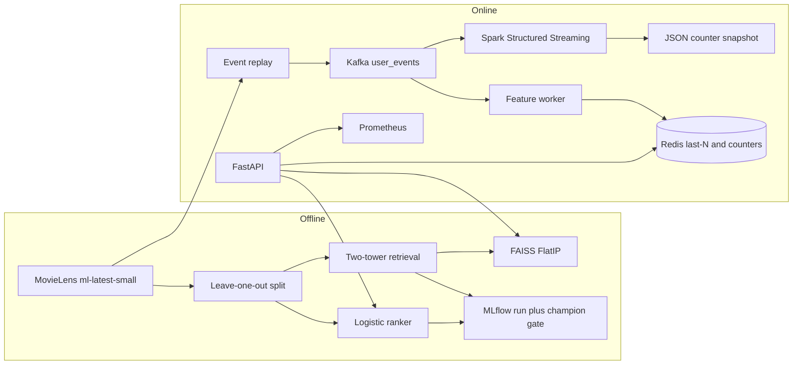

# Shorts recommendation infra

Two-stage short-video recommendation stack for a machine-learning engineer portfolio: a replayed interaction log, Kafka, Spark Structured Streaming, a Redis feature worker, two-tower retrieval with FAISS, a logistic ranker, MLflow, FastAPI, and Prometheus. The offline numbers below were computed in this repo. They are not targets.

MovieLens ml-latest-small is the interaction log. It is a movie-rating dataset, not a short-video watch log. Ratings become view events. `liked` is `rating >= 4`. Watch time is a linear proxy, `watch_time_sec = (rating / 5) * 30`, so the streaming counters have a field to aggregate. The retriever and the ranker do not train on that proxy.

## Resume bullets

- Built a two-stage short-video retriever (two-tower embeddings, FAISS FlatIP, logistic ranker) on MovieLens ml-latest-small. On a leave-one-out split the full stack reached Recall@10 **0.0775** and NDCG@10 **0.0408**, against a popularity baseline of **0.0458** and **0.0247** (568 test users, 6,227-title catalog).
- Streamed the 100,836-rating log through Kafka into Spark Structured Streaming counters and a Redis feature worker, and served recommendations from FastAPI. On a 4-vCPU machine, 300 timed `POST /recommend` calls (Redis unset, one warmup excluded) measured p50 **1.564 ms** and p95 **1.963 ms**, with the same latency histogram exported to Prometheus. A GitHub Actions retrain registers an MLflow champion alias only when two-stage test metrics improve.

## Architecture



Candidate generation is a user-embedding lookup against an exact inner-product index of L2-normalized item embeddings. The ranker reorders the top 100 unwatched titles with five features: retrieval score, log popularity, long-term genre overlap, recent genre affinity, and item mean rating. Recent affinity is the only feature the live stream changes. When Redis has recent item ids for the user, those replace the offline last-five ratings.

## Measured results

Protocol, copied from the run that produced `results/offline_metrics.json`: a positive is a rating of at least 4. Users need at least 5 positives. The last positive is the test item and the previous positive is validation. The two-tower trains only on earlier positives. At test time every other title that user rated is removed from the candidate list. The ranker reorders the top 100 retrieved titles. Users whose test title never appears as anyone's training positive are dropped (35 users). Averages are over the remaining **568** users. Checkpoint selection maximizes validation Recall@10. Reported test numbers are from the promoted checkpoint (seed 7, best epoch 17 of 29).

| Stage | Recall@10 | Recall@50 | NDCG@10 | MRR |
| --- | ---: | ---: | ---: | ---: |
| Popularity | 0.0458 | 0.1444 | 0.0247 | 0.0255 |
| Two-tower retrieval | 0.0546 | 0.1690 | 0.0237 | 0.0223 |
| Retrieval + ranker | 0.0775 | 0.1761 | 0.0408 | 0.0348 |

Validation Recall@10 at the selected epoch was **0.0565**. Catalog: 603 users, 6,227 items, 47,356 training pairs, from 100,836 ratings. `ratings.csv` sha256 `aa289ca83157595d0df6aea1be6a4ded676ddc4385472e8313a8ed9805352646`. Zip sha256 is pinned in code to `696d65a3dfceac7c45750ad32df2c259311949efec81f0f144fdfb91ebc9e436`.

Retrieval beats popularity on Recall@10 and Recall@50 and loses on NDCG@10 and MRR. The ranker is what moves the top of the list: NDCG@10 goes from 0.0237 to 0.0408 and MRR from 0.0223 to 0.0348. That is a real, modest lift on a 6k catalog with an ID two-tower, not a production ranking stack.

Serving latency, from `results/latency.json`, measured against a local uvicorn process with the champion bundle loaded and Redis unset:

| Requests | k | p50 | p95 | mean | Host |
| --- | ---: | ---: | ---: | ---: | --- |
| 300 | 10 | 1.564 ms | 1.963 ms | 1.588 ms | 4 CPUs, Python 3.12.3, Linux |

One warmup request was excluded. The handler also records `shorts_recommend_latency_seconds` and `shorts_recommend_requests_total`.

## Quickstart

From the repo root, with Python 3.11+:

```bash
python3 -m venv .venv
source .venv/bin/activate
pip install -U pip
pip install torch==2.14.1+cpu --index-url https://download.pytorch.org/whl/cpu
pip install -r requirements.txt -r requirements-dev.txt
export PYTHONPATH=src
python -m shorts_recsys.train
pytest
python -m shorts_recsys.serve
```

`train` downloads MovieLens into `data/raw/` (not committed), writes `artifacts/current/` when there is no local bundle or the run beats `results/offline_metrics.json`, and logs the run to `sqlite:///mlruns/mlflow.db`. A repeat run with the same seed that does not beat the file leaves the published metrics in place.

```bash
curl -s http://127.0.0.1:8000/health
curl -s -X POST http://127.0.0.1:8000/recommend \
  -H 'content-type: application/json' \
  -d '{"user_id":1,"k":5}'
```

Full stack, including Kafka, Spark, MLflow, the API, and Prometheus:

```bash
docker compose up --build
```

The API stays unhealthy until the one-shot trainer finishes, which downloads the dataset and trains. Containers talk to Kafka at `kafka:19092`. From the host, the broker is `localhost:9092`. After replay has been consumed:

```bash
curl -s http://127.0.0.1:8000/health
curl -s -X POST http://127.0.0.1:8000/recommend \
  -H 'content-type: application/json' -d '{"user_id":1,"k":5}'
curl -s http://127.0.0.1:8000/features/1
docker compose exec redis redis-cli HGETALL user:1
docker compose exec spark-stream cat /data/stream_features.jsonl | head
```

MLflow is on port 5000. Prometheus is on port 9090 and scrapes `api:8000/metrics`.

Optional Spark-only submit, if you already have a broker:

```bash
spark-submit --master local[1] \
  --packages org.apache.spark:spark-sql-kafka-0-10_2.12:3.5.9 \
  spark/streaming_job.py
```

Set `KAFKA_BOOTSTRAP_SERVERS` to the broker. The Python feature worker is the path the API reads. Spark writes the same view, like, and watch-time counters to a snapshot file and does not keep the last-N item list. Compose does not use `--packages`. The Kafka connector and its runtime jars are vendored in `docker/spark-jars/` (Maven Central coordinates and checksums are in `docker/spark-jars/SHA256SUMS`) so the Spark container can start without Maven. Trainer and replay read `./data` from the host, which is where `python -m shorts_recsys.train` downloads MovieLens.

## Design trade-offs

**MovieLens instead of KuaiRec.** KuaiRec is the closer short-video dataset, and its public dump is awkward to pin in CI. MovieLens ml-latest-small is one megabyte, has a stable URL, and is hashed in `shorts_recsys.config`. The event schema (`view`, `liked`, `watch_time_sec`, genres) is what the streaming jobs consume, so a KuaiRec CSV with those columns can replace the loader without touching Kafka or FAISS. Watch time here is not dwell time. Do not describe it as measured viewing behavior.

**Two-tower in-batch softmax.** The retriever is an ID embedding plus a mean of genre embeddings, L2-normalized, trained with in-batch softmax. It is the shape used in modern candidate generation and it exports a single vector per title for FAISS. On this catalog it is only a small recall lift over popularity and a worse MRR. A tuned ALS model would likely rank the top of the list better. The point of this repo is the serving path around the embeddings, and the table shows the gap instead of hiding it.

**FAISS FlatIP.** 6,227 normalized vectors make exact inner product cheaper and easier to debug than HNSW. Swap the index class when the catalog grows. The offline metrics do not go through FAISS. They use a dense score matrix. A unit test checks that online recent items change rank order, and the API loads the FlatIP index for serving.

**Spark complete-mode aggregation.** The streaming job groups the whole topic on every micro-batch. That matches the Python counters at demo volume and gets expensive as history grows. Production state would be `flatMapGroupsWithState` or a RocksDB state store. The Redis worker is a separate consumer group, so it can keep a last-20 item list that Spark's aggregate does not. The ranker uses the last 5 of those ids for recent genre affinity.

**Logistic ranker.** Five features, a standard scaler, and balanced logistic regression. It trains in a second and the weights are inspectable. It is fit on validation users only: the held-out positive plus hard negatives from the retrieved 100. It never sees the test item as a label. A deep ranker would need a larger log than 47k training pairs to be worth the complexity.

**Champion gate.** `results/offline_metrics.json` is the published bar. MLflow gets a run either way. The `shorts-ranker` alias `champion` moves only when two-stage Recall@10 improves, then NDCG@10, then MRR, or when there is no published file. `--force` overrides that. An equal rerun does not register a new champion. The weekly GitHub Actions workflow (`.github/workflows/retrain.yml`) runs the same command and uploads the decision. It does not push back to the branch.

**Leave-one-out.** Every qualified user has one test item, which keeps the average stable on 600 users. A single global time cut would be closer to an online replay and would leave some users with no test row. Filtering every previously rated title, not only training positives, matches "don't recommend a video they already watched."

**Trust store for the download.** `files.grouplens.org` currently chains to emSign ECC Root CA - G3, which is not in the Debian or certifi bundles used here. `certs/emsign_ecc_root_g3.pem` is that public root, loaded only for the dataset download. The zip is then checked against the pinned sha256.

**Compose shortcuts.** MLflow is started with `--allowed-hosts *` so the trainer can call `http://mlflow:5000`. Containers run as root so the named volumes are writable. The Spark image otherwise starts as uid 185 and cannot create `/data/spark_ckpt` on that volume, so the Spark service sets `user: "0:0"`. Neither belongs in a shared deployment.

## Layout

| Path | Role |
| --- | --- |
| `src/shorts_recsys/train.py` | Train, evaluate, log, maybe promote |
| `src/shorts_recsys/model.py` | Two-tower and in-batch softmax |
| `src/shorts_recsys/ranker.py` | Ranker features and logistic regression |
| `src/shorts_recsys/replay.py` | MovieLens to Kafka |
| `src/shorts_recsys/feature_worker.py` | Kafka to Redis |
| `spark/streaming_job.py` | Spark Structured Streaming counters |
| `src/shorts_recsys/serve.py` | FastAPI and Prometheus |
| `docker-compose.yml` | Kafka, Redis, MLflow, trainer, replay, worker, Spark, API, Prometheus |
| `.github/workflows/ci.yml` | Ruff, pytest, image build |
| `.github/workflows/retrain.yml` | Scheduled and manual retrain |

## Tests and CI

`pytest` covers the metric definitions, the leave-one-out split, the watch-time proxy, two-tower overfitting on a toy identity problem, FAISS bundle load, the effect of online recent items on rank order, the champion comparison, an MLflow alias write against sqlite, the HTTP API, and a local Spark aggregation compared with `UserFeatureState`. CI installs the CPU torch wheel, then lints, tests, and builds the serving image. The test job installs Temurin 17 first: Spark 3.5's Hadoop calls `Subject.getSubject` while creating `JavaSparkContext`, and the JDK 24 default on `ubuntu-latest` rejects that call. The Spark image is not built in CI. `docker compose up` is the check for that service.

## Dataset

F. Maxwell Harper and Joseph A. Konstan. 2015. The MovieLens Datasets: History and Context. ACM Transactions on Interactive Intelligent Systems 5, 4, Article 19. https://doi.org/10.1145/2827872

GroupLens allows research use, requires that acknowledgement, and does not allow a commercial use without their permission. This repo does not redistribute the CSV files. Code in this repository is MIT. See `LICENSE`.
